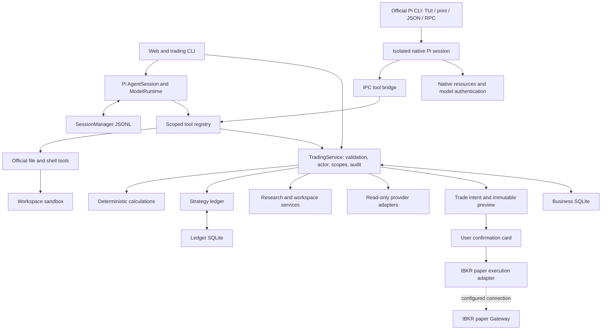

# Architecture

Pi Trading Agent is a local application built around the official Pi 1.6.0 runtime. The application supplies trading tools, persistence, provider adapters, and permission boundaries; Pi owns the agent loop and native conversation format.

## Runtime boundaries

The model can prepare a trade and read its status. Human-only confirmation endpoints are not registered as model tools. A chat response such as “yes” is not an execution capability.

## Modules

| Path | Responsibility |
|---|---|
| `apps/pi-trader/runtime.js` | Construct the standalone application, data directories, ledger, Pi runner, and service. |
| `apps/pi-trader/server.js` | Authenticated loopback HTTP API and static UI. |
| `apps/pi-trader/web/` | Research views, conversations, ledger forms, and broker confirmation cards. |
| `packages/trading/pi-session-runtime.js` | Official AgentSession integration, events, budgets, cancellation, history, and settings. |
| `packages/trading/pi-native-*.js` | Native settings, isolated CLI launch, and IPC bridge. |
| `packages/trading/computer-*.js` | Official file/Shell tools with separate grants and process isolation. |
| `packages/trading/service.js` | Business dispatch, validation, scope enforcement, and audit. |
| `packages/trading/catalog.js` | Operation contracts, extended catalog, and trade catalog. |
| `packages/trading/quant.js` | Pricing, Greeks, IV, scenarios, Wheel constraints, and portfolio calculations. |
| `packages/trading/providers.js` | Fixed read-only market and brokerage transports. |
| `packages/trading/trade-flow.js` | Intent revisions, preview, confirmation capabilities, and order state. |
| `packages/trading/ibkr-execution.js` | Fixed IBKR paper contract, preview, submission, warning, and query endpoints. |
| `packages/trading/storage.js` | Versioned business records and append-only audit events. |
| `packages/ledger/ledger.js` | Integer-cent strategy ledger and reviewed changes. |
| `packages/trading/paper.js` | Separate local simulation account and order book. |

## Data ownership

Pi JSONL is authoritative for native conversation history. SQLite stores the application's UI projection and business records. Editing a conversation creates a branch; it does not replace the source history.

The strategy ledger stores a per-symbol cost convention. It is not a broker tax-lot database. Broker receipts and snapshots do not silently rewrite it.

Data paths are selected with `--home`. File tools operate in a separate workspace, and the native CLI uses a separate resource directory. Source files and application databases cannot be granted as the computer-tool workspace.

## External services

Provider configuration, model credentials, and execution configuration are separate. Read-only data adapters cannot submit orders. The IBKR paper adapter requires an explicit account allowlist and checks the Gateway's paper-session status.

The repository includes controlled-response tests. External account access, data subscriptions, model behavior, and broker execution must be validated in the configured environment.

See [technical design](technical-design.md), [native capabilities](pi-native-capabilities.md), and [conversational trading](conversational-trading.md).
