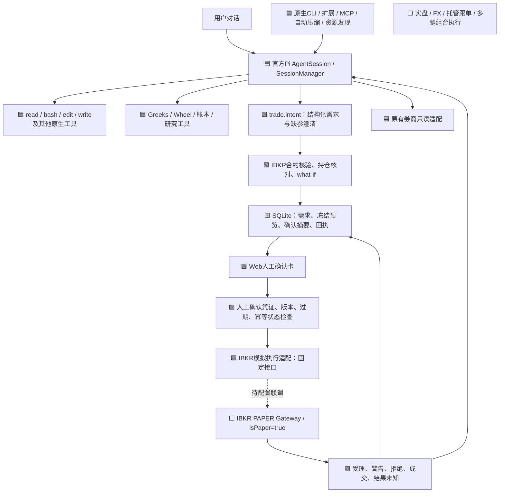
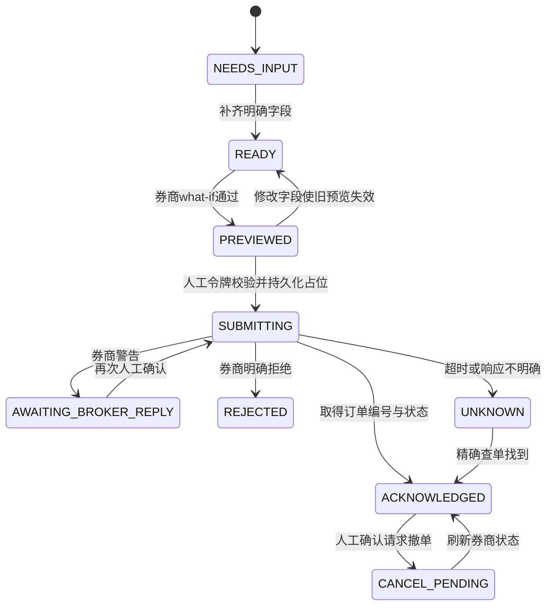

# Conversational trading and IBKR paper execution

Application 3.4.0. The paper adapter supports structured trade preparation and human-confirmed actions. Model and Gateway connections require local configuration. Protocol tests use controlled responses rather than live brokerage access.

## 使用流程与职责

1. 在Pi对话中勾选“交易需求与订单”，说出交易需求。该范围允许模型读取交易需求与回执、查询合约和准备预览，不授予提交权限。
2. 模型通过`trade.intent`提取明确字段。程序返回缺失项，模型继续询问；“买苹果”“卖一张Call”不会被自动补成可执行订单。
3. 用`trade.search`识别标的，期权再用`trade.optionContracts`查询行权价和精确合约。不能凭股票简称推测conid，不能默认期权乘数为100。
4. `trade.prepare`校验完整需求、IBKR模拟会话、选中账户、合约、开平仓、挂单，然后获取行情快照和what-if预览。报价可能延迟或缺失，界面展示原始可用性和警告，不声称实时可成交。
5. 订单卡展示账户、合约、方向、数量、限价、有效期、时段、预估成本、警告。你点击“核对并准备提交”，勾选核对框，再点击最终发送。模型不会接收确认令牌。
6. IBKR若返回警告，卡片进入待确认状态；每一层警告都须你再次确认，程序不会调用警告抑制接口，也不会自动回答是。
7. 回执里的Submitted只表示券商受理。用“从IBKR查单”或让模型调用`trade.refresh`核对部分成交、已成交、拒绝或撤销。当前按需查询，不是后台WebSocket推送。
8. 改价格或数量：未提交需求可在对话中修改，旧预览和确认全部失效。已受理订单可人工确认请求撤单；券商改价、换单和复杂组合订单尚未接入。

## 最新架构与差异

标记：🟦复用，🟩新增，🟨修改，⬜未实现/待外部验收（两者按文字区分）。

原版Pi内核没有被修改。新增模块是`trade-catalog.js`、`trade-flow.js`、`ibkr-execution.js`和Web `trades.js`；修改Service注册、系统提示词、独立trade范围、Web确认入口和原生网络隔离。原有read/bash/edit/write、资源发现、自动压缩、重试、TUI、扩展、MCP及旧本地模拟保持原有配置入口。

| 层 | 原来3.2 | 现在3.3 | 标记 |
|---|---|---|---|
| 模型编排 | Pi调用研究和本地模拟预览 | 增加交易需求提取、缺参、多轮修订与状态解释 | 🟨修改 |
| 计算与个人规则 | 确定性Greeks/Wheel，独立工具 | 继续复用；卖出开仓期权在人工确认链加入硬约束 | 🟦复用＋🟨修改 |
| 券商查询 | 固定只读适配 | 原接口不变 | 🟦复用 |
| 券商执行 | 无执行适配 | 独立IBKR PAPER适配，人工确认，外部待联调 | 🟩新增 |
| 人工确认 | 旧本地Paper确认 | 新增券商订单卡、警告二次确认、撤单确认 | 🟩新增 |
| 权限 | broker、文件、Shell、资源独立 | 增加trade；不把查询或trade授权等同于提交授权 | 🟨修改 |
| 原版能力 | 配置保留、双入口 | 保留，未升级/裁剪上游SDK | 🟦复用 |
| 实盘及商业能力 | 无 | 仍无实盘、FX、托管跟单、BOBBY会员等路径 | ⬜未实现 |

## 数据结构与状态

`records.kind=tradeIntent`保存：`id/revision/chatId`、`fields`、`missing[]`、`sources[]`、`clientOrderId`、`status`、`preview`、`previewHash`、`expiresAt`、`approval`、`wheel`、`brokerOrderId`、`replyId`、`warnings[]`、`receipt`和异常摘要。sources中的对话原句由Service绑定，模型不能传入伪造chatId或sourceMessage。原生CLI创建的需求chatId为空，可在Web“模拟订单”页查看。

`fields`为强类型白名单：accountId、symbol、assetClass、side、positionEffect、quantity、type、limitPrice、currency、timeInForce、session、conid。期权另需expiration、right、strike、multiplier。价格用十进制字符串保存，数量为正整数。当前执行范围是USD股票与单腿期权限价单、DAY/GTC、常规时段；相对描述（如“下周”“ATM”）须先解析成明确日期/行权价供你核对。

ACKNOWLEDGED内部用`receipt.status/filledQuantity/remainingQuantity/avgPrice`区分Submitted、部分成交、Filled、Cancelled；不是受理即成交。SUBMITTING在进程崩溃后保留，30秒后可查单；未知/待警告时阻止新订单提交。未查到不等于失败，不自动重发。cOID是追踪标识，不能声称券商保证Exactly-once；本程序在发出请求前以SQLite事务写状态，重复确认被版本检查拦截。

## 工具与人工接口

| 接口 | 调用方 | 参数摘要 | 行为 |
|---|---|---|---|
| trade.intent | 模型或用户，trade范围 | fields；修订需id/revision，可clear字段 | 保存需求，返回missing，不联网下单 |
| trade.list / get | 模型或用户，trade范围 | chatId可选 / id | 返回脱敏后的业务记录，不含确认凭证或摘要 |
| trade.search | 模型或用户，trade范围 | symbol | 搜索IBKR标的 |
| trade.optionContracts | 模型或用户，trade范围 | symbol/underlyingConid/month；right/strike可选 | 行权价或精确期权合约 |
| trade.prepare | 模型或用户，trade范围 | id/revision | 校验并取得what-if，冻结预览 |
| trade.refresh | 模型或用户，trade范围 | id | 只查询回执；无自动重发 |
| trade.review | 仅人工界面/API | id/revision/action；wheelEvidence可选 | SUBMIT/REPLY/DECLINE/CANCEL，签发120秒令牌 |
| trade.confirm | 仅人工界面/API | id/revision/confirmationToken | 消费令牌并发送绑定动作 |
| trade.discard | 仅人工 | id/revision | 放弃未提交草稿 |

业务目录从91项增至107项，其中60项可按scope暴露给模型、47项仅人工。原生工具另计。Web `POST /api/operations`仍在HttpOnly认证和来源校验下绑定human；模型工具由Service绑定model，不能在JSON参数中提升身份。接口`trade.review/confirm/discard`不注册到Pi模型工具集，原生CLI经IPC同样没有这些工具。

查询配置`providers.ibkr`与执行配置`execution.ibkr`相互独立。执行仅允许本机固定Gateway、DU白名单、`environment=PAPER`，且预览/提交均核查券商`isPaper=true`和selectedAccount。原生扩展出站网络拒绝两份配置的券商地址，Shell仍无网络，不继承应用凭据。

## 期权规则与尚存限制

卖出开仓Call自动按CC、Put自动按CSP检查，不能通过不填策略绕过。人工在确认卡提交`wheelEvidence`，其候选标的、方向、数量、乘数、行权价须匹配冻结订单，`analyzeWheel`须返回ALLOW。证据明确标记HUMAN_RECONCILED_INPUT；模型提供的情景不能自行成为已核对事实。CC仍要求K严格大于(N−P)/Q，拟收权利金不提前冲减成本；CSP仍聚合接货义务、缓冲与费用。

持仓/挂单来自不同请求，不是原子快照；其他客户端仍可能在确认后改变账户。开平仓在预览和提交前重新核对；同一合约已有活跃挂单则阻断。完整账户对账、跨客户端锁定、交割物自动核验、费用入账和税务重建未自动完成。期权到期使用保守的到期日UTC零时截止，不声称交易所日历。成交不会自动改写个人账本。

未实现：真实资金账户、复杂多腿/市价/止损执行、券商改价换单、WebSocket持续推送和自动恢复不确定写入。旧本地条件单预览与本地Paper继续可用，不能将其状态写成IBKR成交。

## 配置与上线阶段

1. **已实现并本地验证**：需求状态机、Pi多轮工具调用、确认卡、Gateway协议适配、版本/过期/重复请求/警告/未知状态与Wheel检查。测试使用明确合成响应，不冒充网络联调。
2. **待用户配置**：运行IBKR Client Portal Gateway并自行登录Paper；选中白名单DU账户。模型provider/model/apiKeyEnv按Pi支持的模型配置；API密钥仅放本机环境，不放聊天或资料库。
3. 将`config.ibkr-paper.example.json`中的execution块合并到所选数据目录的config.json，填写实际DU编号；需要查询时独立配置providers.ibkr。不要覆盖已有数据或整份配置。模板中的DU1234567只是占位。
4. Gateway HTTPS证书必须受Node信任，可用`NODE_EXTRA_CA_CERTS`指定经过核实的证书；不使用`NODE_TLS_REJECT_UNAUTHORIZED=0`。本程序不代登录，不保存券商密码，不自动切换账户或环境。
5. 启动`npm start -- --home <数据目录>`，浏览器开启对话的trade范围。先完成缺参→合约→what-if→人工核对；由你本人最终提交第一笔券商模拟订单，并用IBKR界面核对回执和撤单。此步骤需要在配置好的模拟环境中单独验证。
6. **后续另行实现/验收**：复杂订单、持续成交推送、自动对账；实盘模式不是把PAPER字符串改成LIVE就开放。

测试范围见[验证说明](verification.md)。配置模板默认关闭模型；运行配置保存在数据目录。

## 官方接口依据（2026-11-23查阅）

- [Receive Brokerage Accounts](https://www.interactivebrokers.com/docs/web-api/v1/endpoints/accounts/receive-brokerage-accounts)：isPaper、选中账户和可交易账户。
- [Contract Search](https://www.interactivebrokers.com/campus/trading-lessons/contract-search/)：先搜索标的，再查衍生品定义。
- [Contract Info and Rules](https://www.interactivebrokers.com/docs/web-api/v1/endpoints/contract/find-all-info-and-rules-for-a-given-contract)：唯一合约、资产类型、币种和乘数。
- [What-if Preview](https://www.interactivebrokers.com/docs/web-api/v1/endpoints/orders/preview-order-what-if-order)：预览前查询行情快照、返回费用/保证金字段。
- [Place Order](https://www.interactivebrokers.com/docs/web-api/v1/endpoints/orders/place-order)：受理、警告、HTTP200也可能业务拒绝。
- [Order Reply Messages](https://www.interactivebrokers.com/docs/web-api/trading/orders/order-reply-messages)：警告回复不是最终成交。
- [Web API trading examples](https://www.interactivebrokers.com/campus/ibkr-api-page/web-api-staging/)：订单标识和状态查询字段。

以上链接是接口依据；本应用的输入校验与状态机以源码和本页契约为准。

## 3.4 后续状态与对账

交易卡可逐笔启停后台只读查询；浏览器在可见且未核对订单时自动刷新。`trade.watch` 为人工操作，`trade.monitorStatus` 为 trade 范围查询。未变化回执不再递增需求版本；实际变化使旧确认失效。新增报告流程不会修改原账本或自动提供 Wheel 已核对证据。见 [对账与订单跟踪](reconciliation-and-monitoring.md)。
