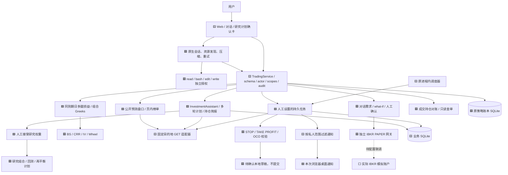

# 个人投资助手：功能、架构与操作流程

版本 3.5.0，2026-11-25。产品目标是个人投资助手功能等效，不建设收费、多用户商业平台或原生手机应用。功能核对依据包括既有 46 项黑盒观察、RockFlow 官方帮助页、公开 MCP 说明，以及本项目代码与测试；这几类证据不能互相替代。

## 本轮交付

| 模块 | 能做什么 | 接口 | 边界 |
|---|---|---|---|
| 多轮投资计划 | 保存目标、风险偏好、期限、预算、排除项和配置提案，追问缺参，检测权重冲突；人工确认后保存研究组合 | `plan.draft/list/get/accept` | 不代填投资条件，不自动买入；已确认计划不能被模型原地改写 |
| 持仓研究 | 从固定快照分析分币种现金、市值和集中度，按所持股票拉取新闻及报价 | `holdings.analyze/brief/reports/report` | 不混算币种；缺价保留未知；不把券商成本当作 Wheel 成本 |
| 多腿期权 | 价差、跨式、宽跨式、蝶式、铁鹰、备兑和保护性期权的到期损益、平衡点、无界尾部和组合 Greeks | `options.strategy` | 1–16 腿、共同标的及到期日；不覆盖跨期估值、提前行权和券商组合保证金 |
| 机会研究 | active/gainers/losers 榜单进入对话研究；原有新闻卡也能继续研究 | `research.opportunities` | 明示供应商排序，不冒充 BOBBY 专有 Hot 排名 |
| 预测市场 | 公开市场页内成交量、低价、绝对涨跌榜；Kalshi 与 Polymarket 实时盘口只读适配 | `predict.board/orderbook` | 数据时点未知保持未知；页内排序不是全市场排名，不视价格为客观概率 |
| 持续任务 | 持仓简报、股票/期权止盈止损及 OCO 条件检查，租约、失败退避、暂停和通知 | `jobs.configure/list/run` | 人工设置；条件触发只建本地待确认草稿，不能自动发送券商订单 |
| 桌面通知 | 用户点击启用，浏览器权限通过后通知新事件 | 设置 → 桌面通知 | 当前浏览器会话及服务需运行；只显示通用提示，不将账户数据放到锁屏 |

新增 15 项业务操作：12 项可依 scope 注册给模型，3 项仅人工。全项目 122 项，72 项模型可用、50 项仅人工；官方基础工具另外管理。

## 架构与差异

标记：🟩 新增，🟨 修改，🟦 复用，⬜ 未实现或待配置。

没有删除底层运行时能力。新增研究模块通过原工具注册表进入模型；它们不掌握提交订单的权限。基础工具、网络、券商只读、模拟执行仍分别授权。

## 数据结构与权限

`investmentPlan`：`id/revision/fields/missing/questions/violations/status/requiredScopes/sourceMessage/portfolioId`。状态为 `NEEDS_INPUT → READY → ACCEPTED`。任何修改使用乐观版本；接受动作事务性保存组合及计划状态。只接收明确给出的投资参数；模型产生的权重一直标记为待人工确认。继承本轮私人范围，接受后的组合继续保留范围，避免通过持久计划绕开券商/账本授权。

`holdingsReport`：固定 `snapshotId`、来源、时点、分币种资产、原始仓位、研究章节、缺失字段及 `requiredScopes`。保存报告与快照在同一事务。读取报告需同时授权 `broker + portfolio + market`；只分析持仓需 `broker + portfolio`。通用文件列表不会泄露这类私有报告。

`assistantJob`：`kind/accountId/conditionId/enabled/intervalMs/nextRunAt/runId/leaseUntil/failures/lastError/reportId/lastResult`。人类创建或启停；模型不能配置任务。租约 180 秒，查询超时 90 秒；失败指数退避，连续 5 次暂停。暂停、更改或租约过期使迟到结果无效。应用重启后从持久记录恢复。一次任务只进行只读查询、研究计算、通知或待确认本地草稿生成。

`options.strategy` 输入：`underlying/currency/legs/totalFees/valuation/maxSpot`。腿为 `STOCK` 或 `OPTION`，包含 `side/quantity/entryPrice`；期权还需 `right/strike/expiration/multiplier/standardDeliverableVerified`，计算 Greeks 时逐腿需 `volatility`。净损益等于全部腿到期价值减建仓现金与费用。全局上限在 0、所有执行价和无穷远尾部求解；不从有限绘图区推断最大亏损。跨期组合拒绝计算。CRR 组合每腿最多 200 步。

`predict.orderbook` 输入 `platform/id/outcomeIndex/depth?`。Polymarket token ID 从该市场元数据解析，不由模型任填；响应必须匹配 token 与 condition ID。Kalshi 使用 `orderbook_fp` 美元和数量字段，另一侧 bid 的补数形成 ask。重复价阶、负数量、越界价格、交叉盘口均拒绝。Kalshi 未提供盘口源时间时保持 `null`；Polymarket 当前只识别明确的毫秒时间戳，不推断其他单位。

## 本地使用流程

1. 启动工作台。原有模型配置完成后，在对话授予组合范围，说明投资目标。助手调用 `plan.draft` 保存需求，继续追问预算、期限、风险偏好和集中度上限。
2. 到“组合与回测”的“我的投资计划”核对全部参数。勾选后确认，生成研究组合。随后可调用原有历史回测、组合风险和再平衡计划；真实历史需要数据订阅。
3. 到“期权与规则”，选择多腿损益接口。使用示例可离线得到 100/110 看涨价差的最大亏损 402 美元、最大收益 598 美元、盈亏平衡点 104.02；示例不代表市场报价。
4. 券商只读配置后，先读取 `broker.snapshot`；用返回的固定快照 ID 调用 `holdings.analyze/brief`。股票最多 8 个进入单次新闻简报，超出数量明确列出；不能自动猜测期权标的映射。
5. 持续简报：以明确账户创建 `HOLDINGS_BRIEF` 任务。条件监控：先建 `conditions.create` 规则，再以规则 ID 创建 `CONDITION` 任务。启用 `scheduler.enabled` 并保持服务运行；也可 `jobs.run` 手动检查。`jobs.list` 显示全局后台开关及每项任务状态。
6. 到“能力与设置”启用本次桌面通知。浏览器关闭后不保证投递；邮件、短信及手机云推送还未接入。
7. 条件触发后读取 `conditions.get`，再用 `conditions.previewTriggered` 重新取得人工确认预览。本地模拟成交与 IBKR 模拟执行是两条独立流程；不能把本地条件草稿称为已在券商挂单。

无需模型、行情或账户的完整样例：`node examples/personal-assistant.mjs`。

## 仍有明确缺口

尚不能宣称“完整复制 BOBBY”。已接受订单的券商原地修改、券商原生止损/OCO、多腿组合原子执行、FX 换汇、多市场非美元执行、自动托管跟单、云端持续运行及移动推送仍未实现。公开资料并不能证明 BOBBY 全部内部功能或算法；原始实测也没有确认真实成交、完整组合回测或商业会员能力。

实际模型、行情订阅、IBKR PAPER、公开预测市场所在网络的访问条件仍需用户配置及验收。本轮使用合成数据与注入传输验证协议；没有发送实际订单，没有使用用户密钥。既有实盘禁用约定保持不变。

## 官方来源

- [BOBBY 官方指南](https://help.rockflow.ai/zh-Hans/docs/innvative-products/rockflow-bobby/)：对话研究、投资偏好、策略与二次确认等产品声明。
- [AI 投资组合](https://help.rockflow.ai/zh-Hans/docs/innvative-products/ai-portfolio/)：多轮需求、策略卡、回测与平台组合产品；平台运营部分不属于本轮个人助手目标。
- [RockFlow MCP](https://rockflow.ai/zh-Hans/mcp)：公开 19 项工具，包括查询、期权、账户、下单/撤单和换汇；是另一公开接口面，不能当作本轮全部已实测。
- [Kalshi 盘口接口](https://docs.kalshi.com/api-reference/market/get-market-orderbook)、[Polymarket 盘口接口](https://docs.polymarket.com/api-reference/market-data/get-order-book)：新增只读适配的字段依据。
