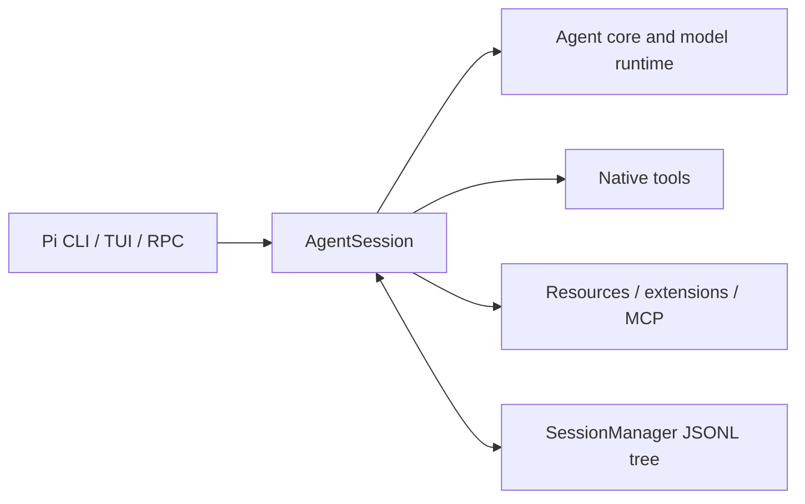

# Pi and the trading application

The application composes Pi Coding Agent 1.6.0; it does not replace the upstream runtime.

The original Pi components remain available through the native entry. The trading Web application uses the same SDK with a scoped tool registry and application-specific persistence. The complete application diagram is in [architecture](architecture.md).

| Component | Pi | Trading application | Relationship |
|---|---|---|---|
| Agent loop and model calls | AgentSession, core, ModelRuntime | Same official implementations | Reused |
| History and branching | SessionManager JSONL | Native history plus SQLite UI projection | Reused; application projection added |
| read/bash/edit/write | Official tools | Official tools behind independent grants | Reused; authorization added |
| Resource discovery | Context files, skills, prompts | Configurable discovery with resource grants | Reused; loading boundary adjusted |
| Compaction and retry | Native settings | Same settings and SDK behavior | Reused |
| TUI, RPC, MCP, extensions | Native CLI | Isolated official CLI with IPC domain tools | Reused; process boundary added |
| Models and credentials | Native authentication and configuration | Separate native resource directory and explicit Web provider settings | Configuration adjusted |
| Trading calculations | Extension responsibility | Greeks, IV, risk, Wheel, backtests | Added |
| Strategy ledger | Application responsibility | Versioned integer-cent SQLite ledger | Added |
| Market and account data | Extension responsibility | Fixed read-only provider adapters | Added |
| Order preparation | Application responsibility | Structured intent and IBKR what-if | Added |
| Broker actions | Application responsibility | Human-confirmed paper-account adapter | Added; external validation required |
| Funded-account trading and commercial services | Outside Pi's scope | No live execution, FX, copy trading, or commercial account integration | Not implemented |

The Web UI does not reproduce every native terminal interaction. Native extensions run through the isolated CLI, and their remote services require configuration. Retaining a native command is distinct from testing every provider, device, or remote integration.
